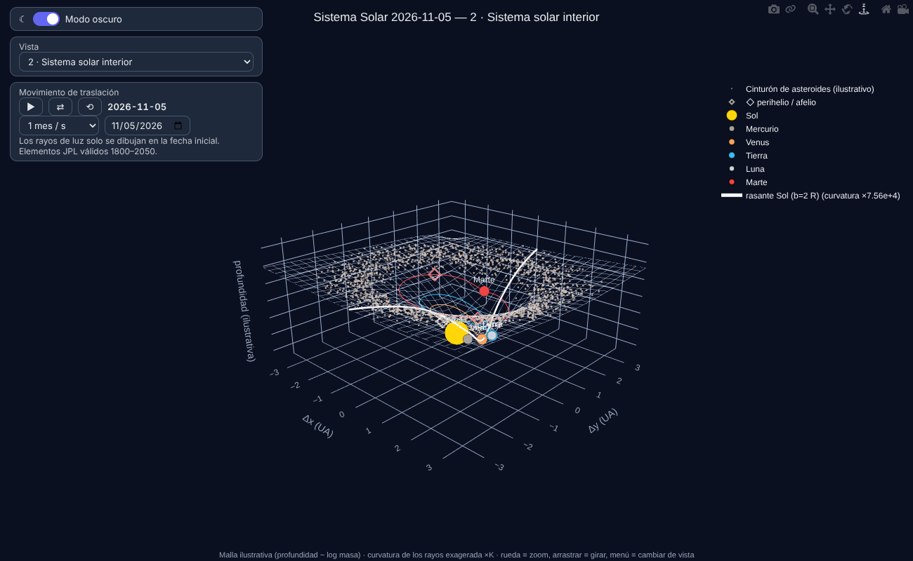
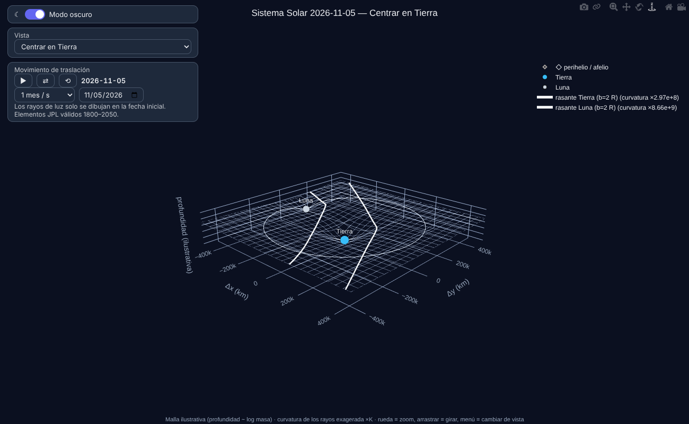
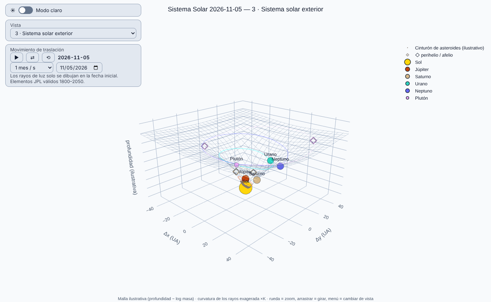

# relmap

**Relatividad general para navegar: calcula cómo se curva la luz, cuánto se retrasan las señales y cuánto
atrasan los relojes en el entorno de una nave, y dibuja el resultado en un mapa 3D que puedes animar.**

Funciona con datos *estimados* (masas, posiciones, incertidumbres) y trae el **Sistema Solar completo**
(Sol, 8 planetas, Plutón y la Luna) listo para usar. Es experimental y está pensado también para **enseñar**:
incluye una guía en PDF para estudiantes y otra para profesores.

> © 2026 Pedro Sordo Martínez · Licencia AGPL-3.0-or-later

| Sistema interior | Tierra y Luna | Sistema exterior (modo claro) |
|---|---|---|
|  |  |  |

---

## 1. Empieza en 3 minutos

Necesitas Python 3.10 o superior.

```bash
python3 -m venv .venv && source .venv/bin/activate
pip install -e ".[dev]"
pytest                                                   # comprueba que la física sale bien (≈ 1 min)
relmap-solar --date 2026-11-05 --offline --out sistema_solar.html
```

Abre `sistema_solar.html` en el navegador (en WSL: `explorer.exe sistema_solar.html`).
`--offline` incrusta Plotly para que funcione sin internet (el archivo pesa ~7 MB); sin él, el archivo es
pequeño pero necesita conexión.

Para la **guía pedagógica**:

```bash
relmap-pdf --nivel ambos          # crea guia_relmap_estudiante.pdf y guia_relmap_profesor.pdf
```
Ya hay una copia generada en [`docs/`](docs/).

---

## 2. La idea en cinco minutos

1. **Gravedad = geometría.** Según Einstein, la masa curva el espacio-tiempo y los objetos libres (la luz
   incluida) siguen las líneas «más rectas» posibles, llamadas **geodésicas**.
2. **Las ecuaciones de campo** `G_μν = 8πG/c⁴ · T_μν` son 10 ecuaciones no lineales: no hay un «solucionador
   universal». Se resuelven por niveles de aproximación:

   | Nivel | Cuándo vale | ¿En relmap? |
   |---|---|---|
   | Solución exacta de un cuerpo (**Schwarzschild**) | una masa esférica, incluso campo fuerte | Sí |
   | **Campo débil**, varios cuerpos | \|Φ\| ≪ 1 (estrellas, planetas) | Sí |
   | Relatividad numérica | agujeros negros que se fusionan | No |

3. **El método**, paso a paso:
   *datos estimados → unidades geométricas (G = c = 1) → métrica → geodésicas (ecuaciones diferenciales) →
   ángulos, retrasos y relojes → mapa; y Monte Carlo para propagar incertidumbres.*
4. **Campo débil = óptica.** En el Sistema Solar la luz se comporta como en un medio con índice de refracción
   `n = 1 − 2Φ`, donde `Φ = −Σ GMᵢ/(c² rᵢ)`. Eso permite sumar el efecto de cada cuerpo.

La explicación completa, con ecuaciones, figuras y ejercicios, está en las guías PDF
([estudiante](docs/guia_relmap_estudiante.pdf) · [profesor](docs/guia_relmap_profesor.pdf)).

### Lo que el programa verifica contra resultados conocidos
- **1,75″**: deflexión de la luz rozando el Sol (el doble de la predicción newtoniana).
- **42,98″ por siglo**: precesión del perihelio de Mercurio, integrando su órbita.
- Retraso de Shapiro frente a su fórmula analítica `4M·arsinh(a/b)`.
- Dilatación temporal de la Tierra: 6,95·10⁻¹⁰.
- Acuerdo entre campo débil y Schwarzschild exacto; cancelación por simetría; superposición.

---

## 3. El mapa interactivo

Se genera con `relmap-solar` y se maneja desde el panel de la izquierda:

| Control | Qué hace |
|---|---|
| **Modo oscuro / claro** | interruptor (arranca en oscuro) |
| **Vista** | **1 · Todo el sistema**, **2 · Sistema solar interior**, **3 · Sistema solar exterior** (la frontera es el **cinturón de asteroides**), y **Centrar en…** cualquier cuerpo (la cámara lo sigue) |
| **▶ / ⏸** | reproduce o pausa el **movimiento de traslación** de los planetas |
| **⇄** | invierte el sentido del tiempo |
| **⟲** | vuelve a la fecha inicial |
| **Velocidad** | de 1 día/s a 100 años/s |
| **Fecha** | salta a cualquier fecha entre 1800 y 2050 |
| Ratón | rueda = zoom · arrastrar = girar · clic en la leyenda = ocultar |

Qué ves:
- **Colores:** el amarillo es solo del Sol; cada cuerpo tiene el suyo.
- **Órbitas elípticas reales**, con rombos ◇ en el perihelio y el afelio de las más excéntricas
  (Mercurio, Marte, Saturno, Plutón).
- **Cinturón de asteroides** entre 2,1 y 3,3 UA, con los huecos de Kirkwood.
- **Rayos de luz rasantes** (solo en la fecha inicial) con su curvatura exagerada ×K (se indica en la leyenda).

> ⚠️ **La malla es ilustrativa.** Su profundidad es proporcional al logaritmo de la masa; si estuviera a escala
> real los planetas serían invisibles junto al Sol. Los números físicos están en las tablas de la terminal.

---

## 4. Referencia de comandos

### `relmap-solar` — el Sistema Solar
```bash
relmap-solar --date 2026-11-05 --out sistema_solar.html --offline
relmap-solar --include Sol Tierra Luna --b-factor 3          # solo algunos cuerpos
relmap-solar --rays mis_rayos.yaml --mc 100                   # tus rayos + incertidumbre
relmap-solar --dump escena_solar.yaml                         # guarda la escena para editarla
```
Opciones: `--date` (ISO, por defecto hoy), `--include`, `--b-factor` (parámetro de impacto en radios),
`--rays`, `--mc N` (muestras Monte Carlo), `--seed`, `--out`, `--dump`, `--exaggerate`, `--no-belt`, `--offline`.

La terminal muestra una tabla: deflexión **total** (todo el sistema actuando sobre el rayo) y **aporte** del
propio cuerpo (total − el mismo rayo sin él), que coincide con la fórmula `4GM/(bc²)`; el retraso de Shapiro,
la dilatación temporal en cada superficie y los elementos orbitales (a, e, q, Q) de cada órbita.

### `relmap` — tus propias escenas
```bash
relmap examples/sistema_solar.yaml --mc 200 --out mapa.html
```

### `relmap-pdf` — guía pedagógica
```bash
relmap-pdf --nivel estudiante|profesor|ambos [--date 2026-11-05] [--out guia.pdf]
```
Requiere `pip install -e ".[pdf]"` (reportlab y matplotlib; ya incluidos en `[dev]`).
Todos los números del PDF se calculan al generarlo con el propio código.

### Formato de escena (YAML o JSON)
```yaml
unit: au                  # m, km, au, ly, pc, rsun  (posiciones, longitudes y radios)
bodies:
  - name: Sol
    mass: 1.0
    mass_unit: msun       # kg, msun, mearth, mjup
    position: [0, 0, 0]
    radius: 0.0046505     # opcional; 0 = cuerpo puntual
    mass_sigma_rel: 0.01  # incertidumbre relativa de la masa
    position_sigma: 0.0   # incertidumbre de la posición (en la unidad de arriba)
    color: "#FFD60A"      # opcional
rays:
  - {name: rayo, origin: [-5, 0.0047, 0], direction: [1, 0, 0], length: 10}
```

### Como biblioteca de Python
```python
from datetime import datetime, timezone
from relmap import solar_system_bodies, default_rays, trace_ray, monte_carlo

bodies = solar_system_bodies(datetime(2026, 11, 5, tzinfo=timezone.utc))
ray = default_rays(bodies)[0]                    # rasante al Sol
res = trace_ray(bodies, ray.origin, ray.direction, ray.length)
print(res.deflection_arcsec, res.delay_s)        # ≈ 0.8756″ y ≈ 150 µs
```
Fase 1 (un cuerpo, campo fuerte): `integrate_null` y `integrate_timelike` (geodésicas de Schwarzschild).

---

## 5. Preguntas frecuentes

**¿Por qué las órbitas parecen casi circulares?** Porque lo son *casi*. Una elipse con excentricidad *e* tiene el
semieje menor `a·√(1−e²)`. Para la Tierra (e = 0,0167) es solo un 0,014 % más corto que el mayor: no se ve. Lo
que sí cambia es que el Sol está en un **foco**, no en el centro (desplazado `a·e`). Mercurio (e ≈ 0,21) y Plutón
(e ≈ 0,25) sí son claramente elípticos; el perihelio de Plutón (≈ 29,7 UA) queda dentro de la órbita de Neptuno.

**¿Dónde está la Luna?** En la vista **Centrar en Tierra** (o **Centrar en Luna**) se ve con su órbita; en las
vistas generales es demasiado pequeña para distinguirse de la Tierra.

**¿Qué es el cinturón de asteroides y por qué separa interior y exterior?** Es la región entre Marte y Júpiter
(≈ 2,1–3,3 UA) con millones de cuerpos menores. Separa los planetas **rocosos** interiores de los **gigantes**
exteriores. La nube del mapa es *ilustrativa*, no asteroides reales. En esa zona, la regla de Titius-Bode
«predecía» un planeta; Olbers propuso en 1802 que era un planeta destruido (hipótesis del «Faetón»), pero hoy se
descarta: la masa total del cinturón es solo ≈ 4 % de la de la Luna y su composición es muy variada.

**¿Por qué el rayo de la Tierra marca 0,00099″ y su «aporte» solo 0,00029″?** Porque el total incluye el campo del
Sol actuando a lo largo de todo el trayecto; el «aporte» aísla a la Tierra.

**¿Se puede usar para navegar de verdad?** No: es una herramienta educativa y de exploración. Las posiciones son
aproximadas (ver más abajo) y el campo débil no vale cerca de agujeros negros.

---

## 6. Datos y precisión

- **Posiciones:** elementos keplerianos aproximados de JPL (E. M. Standish; válidos 1800–2050). Errores
  nominales: Mercurio ≈ 1 000 km, Venus ≈ 4 000, Tierra ≈ 6 000, Marte ≈ 25 000, Júpiter ≈ 600 000,
  Saturno ≈ 1,5 millones, Urano ≈ 1 millón, Neptuno ≈ 200 000 km.
- **Masas y radios:** JPL *Planetary Physical Parameters*.
- **Plutón:** JPL retiró a Plutón de su tabla; se usan los elementos de la tabla original de Standish,
  reproducidos en bibliotecas abiertas (pykep, satkit). **No hay error de posición publicado**: usamos
  30 millones de km como estimación gruesa.
- **Luna:** órbita circular de 384 400 km inclinada 5,145° (error de decenas de miles de km).
- **Precisión numérica:** integrador DOP853 con tolerancia 10⁻¹²; para aportes de ~10⁻¹¹ rad se usa 3·10⁻¹⁴.
- **El error de posición manda:** si es mayor que el parámetro de impacto de un rayo, el efecto de lente de ese
  cuerpo se pierde en el ruido (no es un fallo: es física).

## 7. Límites

- Campo débil y cuerpos estáticos mientras pasa la luz. Para un solo cuerpo en campo fuerte, usa Schwarzschild.
- Sin planetas enanos distintos de Plutón, asteroides reales ni lunas de otros planetas (faltan elementos fiables).
- Los rayos de luz solo se dibujan en la fecha inicial (no se recalculan al animar).
- Sin relatividad numérica.

## 8. Estructura del proyecto

```
src/relmap/
  units.py          constantes y unidades geométricas
  geodesics.py      Schwarzschild: luz y masas de prueba (Fase 1)
  weakfield.py      campo débil multi-cuerpo, rayos, Shapiro, relojes (Fase 2)
  uncertainty.py    Monte Carlo
  scene.py          lectura de escenas YAML/JSON
  solar_system.py   catálogo: elementos orbitales, Luna, Plutón, cinturón (Fases 3-4)
  scene_map.py      mapa 3D interactivo + animación (motor en JavaScript)
  cli.py            relmap          solar_cli.py   relmap-solar
  pedagogy.py       guía PDF         pdf_cli.py     relmap-pdf
tests/              95 pruebas (física, catálogo, PDF y navegador real)
docs/               guías PDF y capturas
examples/           escenas de ejemplo
```

## 9. Hoja de ruta
- Posiciones exactas desde **JPL Horizons** (script que descargas tú) para sustituir las aproximadas.
- Planetas enanos (Ceres, Eris…) y lunas de los gigantes.
- Órbitas multi-cuerpo con correcciones post-newtonianas.
- Guías en inglés.

## 10. Créditos y licencia
Datos orbitales y físicos: NASA/JPL. Plutón: tabla original de Standish. Motor numérico: SciPy; gráficos: Plotly;
PDF: ReportLab y Matplotlib. Código bajo **AGPL-3.0-or-later**.

**Autor:** Pedro Sordo Martínez — amurlaniakea@gmail.com
